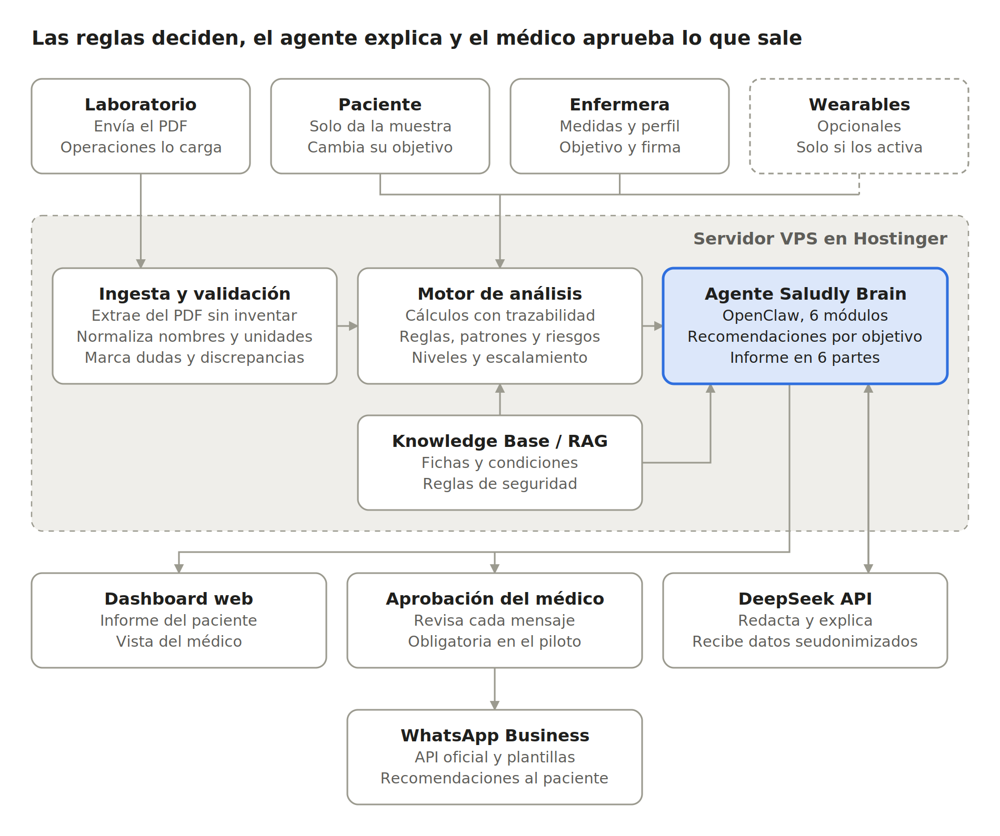
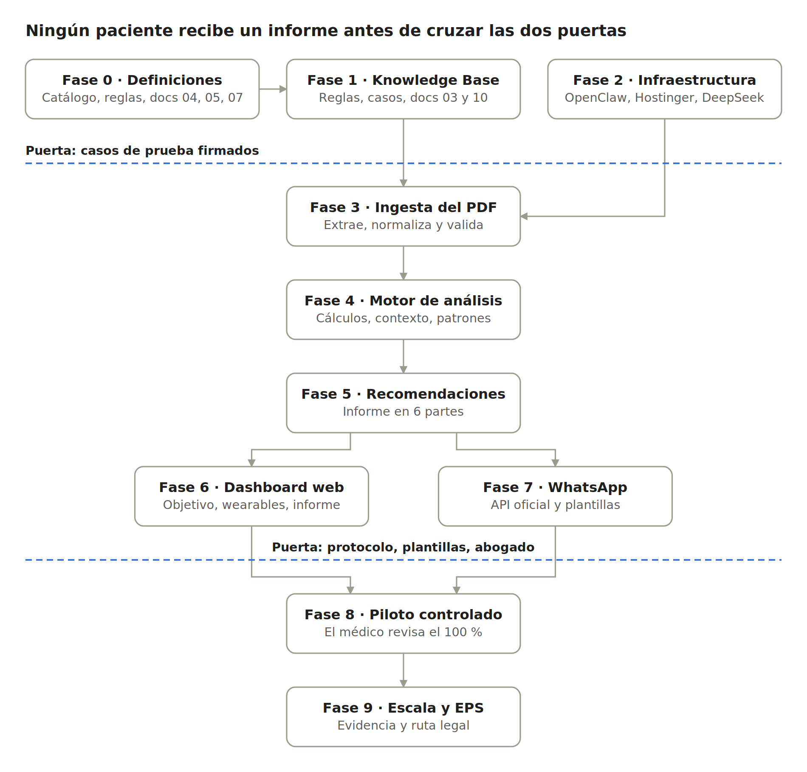

# Saludly — Documento de proyecto y plan de implementación

6 de octubre de 2026 · Luis Alfredo Mera

## Contexto de negocio

Saludly es una empresa de salud preventiva con sede en Bogotá. Antes hacía exámenes de laboratorio a domicilio; ahora toma una sola muestra, un laboratorio aliado la procesa y envía los resultados, y Saludly Brain, un agente de IA médico entrenado con guías clínicas certificadas, busca patrones entre los biomarcadores para señalar riesgos de enfermedades o condiciones.

**Qué recibe el usuario.** Un informe en el dashboard web con seis partes: resumen general, lo que está bien, lo que merece atención, qué podría significar, qué puede hacer y cuándo consultar. Las recomendaciones (alimentación, hidratación, actividad física, sueño, hábitos, vitaminas y terapias) le llegan además por WhatsApp.

**Qué hace el paciente.** Nada más que dar la muestra de sangre, abrir el dashboard y recibir los mensajes de WhatsApp. No llena formularios ni carga archivos: los datos de perfil, las medidas y los consentimientos los toma la enfermera en la visita.

**Cómo llega el resultado.** El laboratorio aliado envía el PDF a Saludly, siempre en un mismo formato, y el equipo de Saludly lo carga al agente para que lea valores y metadatos. Mientras llega el formato real, Saludly arma su propio PDF de ejemplo.

**Qué lo hace personal.** Cada paciente tiene un objetivo de salud (por ejemplo mejorar su salud, correr una maratón o bajar de peso) y las recomendaciones se ordenan según ese objetivo. Si quiere, conecta un wearable desde el dashboard; cuando lo activa, el agente usa esos datos como contexto para los patrones, por ejemplo los de cardiología.

**Para quién sirve.** El médico ve en un solo lugar lo que pasa con el paciente y decide con más información. El paciente descubre a tiempo si algo anda mal, con una sola prueba.

**Modelo de negocio objetivo.** Carlos, CEO de Saludly, plantea que las EPS paguen el servicio por paciente con cargo a la UPC, siempre con aprobación previa del paciente. La tesis: detectar a tiempo riesgos reales y tratarlos oportunamente reduce el costo de la UPC a largo plazo.

**Stack definido.** OpenClaw desplegado en Hostinger como entorno del agente, DeepSeek como LLM de interpretación y un RAG clínico organizado en 6 módulos de 2 especialidades cada uno (12 en total). La integración con los wearables todavía no está definida.

## Decisiones tomadas (6 de octubre de 2026)

Las decisiones de la Fase 0 quedaron cerradas. Donde el equipo dejó la decisión a mi criterio, seguí las propuestas de los lotes y las dejé escritas en la serie de Saludly Brain; esas decisiones clínicas necesitan la firma de un médico antes de usarse con pacientes reales.

| Decisión | Qué cambia |
|-------------|--------------------------|
| Lotes 4, 5 y 6 aprobados | El catálogo y las condiciones quedan cerrados |
| VIH, sífilis, clamidia y gonorrea fuera | 50 condiciones incluidas; Infectología queda con hepatitis B, hepatitis C y Chagas |
| Conflictos entre guías a mi criterio | Adopté la propuesta de cada lote (documento 03, sección 03.6) |
| Vitaminas, objetivos y wearables aprobados | Reglas definitivas en los documentos 03 y 07 |
| Cortisol, ACTH y hormonas del ciclo a mi criterio | Cortisol solo con toma entre 6:00 y 10:00; ACTH interpretada solo para el médico; hormonas del ciclo según fecha de última menstruación; progesterona solo en mujeres (109 valores por hombre, 111 por mujer) |
| Todas las tomas en ayunas | Confirmado en el protocolo |
| Relaciones: patrón o vigilar a mi criterio | Patrón si tiene guía o ya es condición de los lotes; vigilar si es asociación (documento 03, sección 03.7) |
| El laboratorio no entrega formato | Saludly inventó su PDF con el estilo colombiano: dos ejemplos, órdenes LCD-2026-100123 (hombre) y LCD-2026-100124 (mujer) |
| Documentos 01 y 03 a 10 | Escritos en versión 1 |
| Primer wearable: Apple Watch | Apple Health solo se lee desde el iPhone: hace falta una app iOS mínima. El reloj no mide presión; la presión llega de un tensiómetro registrado en Apple Health |
| Plan de Hostinger | Lo compra el equipo al llegar a la Fase 2 |
| Abogado | Transferencia de datos a DeepSeek y ruta con EPS aprobadas; INVIMA sigue pendiente |
| Modelo de lenguaje | DeepSeek en la nube para pruebas; modelos locales con GPU en operación |
| Asumido sin confirmación explícita | Los 7 datos de perfil aprobados, promesa "más de 100 biomarcadores" y sin dinamómetro en la versión 1 |

## Cómo funciona Saludly Brain

El documento 02 define el producto en 13 pasos, desde que el usuario se hace el examen hasta que recibe el informe. No define servidores ni proveedores; este plan los agrega y ubica cada paso en una fase.

| Paso del documento 02 | Qué tiene que pasar | Fase donde se construye |
|-------------|-------------------------|----------|
| 1 · Usuario | Solo da la muestra, en ayunas y en la mañana; la enfermera toma medidas, perfil, objetivo y consentimientos | 0 (protocolo) y 8 (piloto) |
| 2 · Resultado de laboratorio | El laboratorio aliado procesa la muestra y las reflejas | 0 (acuerdo con el laboratorio) |
| 3 · Ingesta del PDF | El laboratorio envía el PDF a Saludly y el equipo de Saludly lo carga al agente | 3 |
| 4 · Extracción | Nombre, valor, unidad, rango, fecha, banderas y método, sin interpretar | 3 |
| 5 · Normalización y validación | Cada resultado a su identificador interno; nada inventado; dudas marcadas | 3 |
| 6 · Cálculos | Derivados solo con variables completas y condiciones de validez | 4 |
| 7 · Contexto del usuario | Lo que tomó la enfermera (perfil, objetivo, medidas, cuestionario) y wearables si están activos | 4 (uso) y 6 (captura) |
| 8 · Knowledge Base / RAG | Fichas, condiciones y reglas de seguridad consultables | 1 (contenido) y 2 (índice) |
| 9 · Motor de análisis | Junta resultados, cálculos, contexto y conocimiento | 4 |
| 10 · Detección de patrones | Relaciones entre varios parámetros, nunca un valor aislado como diagnóstico | 4 |
| 11 · Evaluación de riesgos | Nivel de coincidencia, escalamiento e incertidumbre explícita | 4 |
| 12 · Recomendaciones | Acciones por hallazgo, ordenadas según el objetivo del usuario | 5 |
| 13 · Informe final | Las seis partes del informe en el dashboard y las recomendaciones por WhatsApp | 5, 6 y 7 |

Tres precisiones al documento 02, para que el desarrollo no tenga que adivinar:

- **Quién carga el PDF.** El documento 02 dice que lo carga el usuario. En la operación real el laboratorio se lo envía a Saludly y el equipo de Saludly lo carga al agente; el paciente no toca el PDF.
- **Cómo se extrae.** El documento dice que la IA convierte el informe en datos. Como el laboratorio usará un solo formato, recomiendo un lector hecho para ese formato, con la IA solo como respaldo y siempre con validación. Mientras llega el formato real, el lector se construye sobre un PDF de ejemplo hecho por Saludly.
- **Cuatro niveles de lenguaje.** Resultado observado, patrón compatible, riesgo potencial y condición que requiere evaluación médica. Cada hallazgo lleva uno, y se cruza con el nivel de coincidencia (alta, moderada, baja) y el escalamiento (0 a 3) de los lotes.

## Estado actual del proyecto

El producto ya tiene definido qué hace (documento 02) y una base clínica avanzada, pero no hay nada técnico construido y la serie de Saludly Brain ya está escrita en versión 1. Lo que existe es conocimiento en Markdown que una máquina todavía no puede usar sin ambigüedad.

| Pieza | Qué hay hoy | Lo que falta |
|----------|-----------------|-----------------|
| Documento 02 · Arquitectura funcional | Flujo de 13 pasos, reglas de extracción y validación, estructura del informe en 6 partes y tipos de recomendación | Nada para empezar; las tres precisiones de la sección anterior |
| Documentos 01 y 03 a 10 | Escritos en versión 1 el 6 de octubre de 2026 | Firma médica de las decisiones clínicas de los documentos 03, 04, 05 y 07 |
| Matriz de condiciones (Lotes 1 a 6) | 12 especialidades, 50 condiciones incluidas y 27 de apoyo, con patrón, guía y detectabilidad | Patrones en tablas de texto, no en reglas ejecutables. Aprobaciones de Carlos en los Lotes 4, 5 y 6; conflictos entre guías en 5 de los 6 lotes |
| Consolidado | Panel estándar de 74 analitos medidos, 7 calculados, edad biológica y 18 reflejas | Ampliarlo a 100 o más con las fichas que no están en los lotes y aprobarlo |
| Fichas de biomarcadores | 100 fichas con interpretación, seguridad para Saludly Brain y bloque RAG_INSTRUCTIONS; 99 completas y 1 parcial (IGF-1) | 11 fichas con el esquema viejo; campo general_panel desactualizado; fichas faltantes para 22 analitos del panel |
| Protocolo de toma domiciliaria | Borrador 0.1 con requisitos por tubo y 11 preguntas al laboratorio | Respuesta firmada del laboratorio; transporte congelado para vitamina C; requisitos de los analitos nuevos |
| Dashboard | Un mock con 112 biomarcadores (src/data/biomarkers.ts), según el Lote 6 | Panel definitivo, informe en 6 partes, objetivo de salud y conexión de wearables |
| Agente, RAG, WhatsApp, laboratorio, wearables | Nada construido | Todo |

### Verificación de fuentes por lote

Los lotes 4, 5 y 6 casi no tienen fuentes leídas completas, y son los que traen las condiciones más sensibles (infecciones, hormonas, PSA, ANA).

| Lote | Leídas completas | Solo confirmadas por búsqueda |
|--------------------|-----------|-----------|
| 1 · Cardiología y Metabolismo | 5 | 7 |
| 2 · Nefrología y Tiroides | 5 | 4 |
| 3 · Hematología y Nutrición | 3 | 5 |
| 4 · Gastroenterología e Infectología | 1 | 13 |
| 5 · Mujer y Hombre | 1 | 9 |
| 6 · Reumatología y Medicina interna | 1 (es el mock del dashboard, no una guía) | 14 |

El Lote 2 es el único con decisiones, acuerdos con el laboratorio y conflictos del médico revisor marcados como cerrados.

## Catálogo de biomarcadores: 100 o más

Sumando al panel de los lotes las 30 fichas que no aparecen en ellos, el catálogo queda en 99 analitos medidos, 12 calculados y la edad biológica: 112 valores. Por persona son 111 en mujeres y 109 en hombres, porque FSH, prolactina y progesterona son solo femeninas y PSA solo masculino.

| Nivel | Qué entra | Qué hace el agente |
|----------|-----------------|-----------------|
| Con patrón | Los biomarcadores que alimentan alguna de las 50 condiciones de los lotes | Los usa en patrones, con nivel de coincidencia, escalamiento y guía |
| Solo valor y rango | Los biomarcadores que no alimentan ninguna condición, incluidos los 30 nuevos | Muestra el valor, el rango del laboratorio y si está en rango o fuera. Si su ficha tiene reglas de escalamiento, las respeta |
| Vitaminas | Las 14 del panel | En rango o fuera, y recomendaciones según la regla de abajo |
| Reflejas | 18 pruebas que el laboratorio corre solo si un resultado las activa | Se interpretan cuando aparecen; no cuentan en la promesa comercial |

### Los 30 que entran desde las fichas

**Medidos (25):** ACTH, ApoA1, BUN, péptido C, cloro, CK, cortisol, DHEA-S, estradiol, fibrinógeno, fructosamina, troponina de alta sensibilidad, IGF-1, IgG, IgM, LDH, LH, magnesio, eritroblastos circulantes (NRBC), osmolalidad, progesterona, tiempo de protrombina, proteínas totales, transferrina y zinc.

**Calculados (5):** relación albúmina/globulina, relación ApoB/ApoA1, relación BUN/creatinina, globulinas e INR.

Algunos de estos se habían sacado en los lotes por una razón clínica, y la razón no desaparece al volver a medirlos:

- **Troponina hs:** su ficha dice que cualquier valor alto exige evaluación profesional, siempre. En este catálogo, fuera de rango no puede quedar como "solo un valor": dispara la llamada del equipo médico.
- **Cortisol y ACTH:** sus fichas piden no ofrecerlos en un panel autoiniciado y dependen de la hora de la toma. La toma es en ayunas y en la mañana, lo que ayuda, pero el médico debe aprobar cómo se muestran.
- **LH, estradiol y progesterona:** dependen del día del ciclo. Necesitan la fecha de última menstruación del perfil para mostrar el rango correcto.
- **IGF-1:** su ficha está en estado PARCIAL; hay que completarla.

Dos consecuencias operativas: el laboratorio debe cotizar 25 pruebas más, y la coagulación (tiempo de protrombina, INR y fibrinógeno) usa un tubo distinto que hay que sumar al protocolo de toma.

### Regla de vitaminas

Esta regla reemplaza la del Lote 6, que dejaba las vitaminas como informativas y sin recomendaciones. Ahora cada vitamina se marca en rango o fuera para poder recomendar.

1. Comparar con el intervalo de referencia del laboratorio y marcar bajo, en rango o alto. Si el laboratorio no reporta intervalo (puede pasar con el índice omega-3, la relación omega-6/omega-3 o la CoQ10), se muestra solo el valor; hay que confirmarlo con el laboratorio.
2. **Bajo:** recomendar alimentos que la aportan. El suplemento se menciona como opción general para hablar con el médico, sin dosis y sin presentarlo como prescripción, como pide el documento 02.
3. **Alto:** preguntar por suplementos. Si son vitamina A o E, sugerir consulta, porque se acumulan en el cuerpo.
4. **Biotina alta:** no interpretar TSH, T4 libre, B12 ni folato hasta repetirlos sin el suplemento, porque la biotina altera esos inmunoensayos (Lote 6, con advertencia de la FDA).
5. **Vitamina C:** solo se marca si el laboratorio validó el transporte congelado; sin eso el resultado sale falsamente bajo.
6. **Vitamina D:** se marca en rango o fuera, pero el texto de la recomendación lo aprueba el médico revisor, porque la Endocrine Society 2024 no respalda suplementar por encima de la ingesta recomendada en adultos sanos menores de 75 años (Lote 3).
7. **B12 y folato:** además de la regla general, siguen alimentando las condiciones de déficit de B12 o folato, que sí tienen guía y escalamiento.

## Relaciones entre biomarcadores

El documento "Relaciones entre 100 biomarcadores" cubre el mismo catálogo de las fichas y agrega lo que a los lotes les falta: cómo se conectan biomarcadores de módulos distintos. Entra como una capa de patrones entre módulos encima de las 50 condiciones, no como condiciones nuevas, y cada relación necesita su fuente verificada antes de usarse.

La mayoría de sus grupos ya existen como condiciones en los lotes (dislipidemia, prediabetes, enfermedad renal, anemia, hipotiroidismo). Lo nuevo es la conexión entre módulos y las relaciones con músculo, hormonas y wearables.

| Parte del documento | Qué aporta | Dónde entra |
|----------|-------------------|------------|
| Lista de 100 biomarcadores | Coincide con las fichas, salvo que agrupa tiempo de protrombina con INR y creatinina con TFGe, y suma HCM y neutrófilos %, que no tienen ficha | Fase 1: HCM y neutrófilos % pasan a las fichas por escribir |
| 8 grupos de relaciones | Cardiometabólico; aterogénico; hígado, inflamación y músculo; riñón; hierro e inflamación; tiroides; vitamina D, minerales y PTH; hormonas, sueño y wearables | Fase 1 (reglas) y Fase 4 (evaluación entre módulos) |
| Matriz de relaciones | Un formato por relación: biomarcador A y B, dirección, mecanismo, resultado, fuerza de evidencia, confusores, repetición, acción permitida y prohibida, fuente | Fase 1: formato de cada relación en el Knowledge Base |
| Motor de interpretación | Estados del dato, niveles de clasificación, mínimo de señales, confusores y campos de salida | Fases 3 y 4 |
| Riesgos a evitar | Frases prohibidas ("tienes diabetes", "toma esta dosis", "el wearable detectó una enfermedad") y el lenguaje que las reemplaza | Documento 05 y control de salida de la Fase 4 |
| Fuentes | Jerarquía de evidencia: guías, revisiones, cohortes, fichas de laboratorio | Coincide con los lotes; las guías colombianas siguen primero |

### Reglas que adopto para el motor

1. **Estados del dato:** no medido, no detectable, menor que el límite de detección e inválido son cuatro cosas distintas; ninguna se trata como cero.
2. **Clasificación:** no interpretable, bajo, limítrofe, en rango, alto y crítico. Limítrofe solo donde una ficha o una guía lo definan; crítico solo con bandera del laboratorio o umbral escrito en una guía (regla del Lote 1). Esto reemplaza el "bajo, en rango o alto" del catálogo, vitaminas incluidas.
3. **Patrones:** al menos dos señales concordantes y una explicación biológica plausible. Primero se evalúa cada módulo y después los patrones entre módulos.
4. **Confusores** antes de nombrar un patrón: infección, ejercicio intenso, deshidratación, alcohol, dieta, menstruación, embarazo, medicamentos, suplementos y sueño. Varios se preguntan en la visita de la enfermera.
5. **Comparaciones:** nunca entre laboratorios distintos sin advertirlo.
6. **Vista del médico:** suma qué datos faltan, qué conviene confirmar y preguntas para el profesional.

### Lo que hay que verificar antes de usarlo

- **Fuentes:** varias citas no traen DOI ni página exacta. Cada relación pasa por el mismo registro de fuentes de los lotes.
- **Fuerza de evidencia desigual:** algunas relaciones tienen guía detrás (albuminuria con TFGe en KDIGO; ApoB y Lp(a)); otras son asociaciones, como vitamina D baja con hs-CRP alta, o hierro bajo con anticuerpos tiroideos, que el propio documento aclara que no demuestra causa. Las de asociación entran como "vigilar", con coincidencia baja, nunca como condición.
- **Datos que Saludly no tiene:** algunos patrones piden "síntomas clínicos" o "ciclo irregular". Si la enfermera no los pregunta, el patrón queda incompleto y el agente lo dice.
- **Regulación:** el documento cita a la FDA y la OMS; para Colombia la pregunta sigue siendo el INVIMA.

El documento propone guardar la matriz como un grafo de conocimiento (biomarcadores, mecanismos, condiciones, confusores, wearables, evidencia y acciones). Cómo almacenarla se decide en el documento 03; el formato de cada relación ya queda definido.

## Objetivo de salud del usuario

La enfermera pregunta el objetivo en la visita: uno principal y, si el paciente quiere, uno secundario. Después el paciente puede cambiarlo desde el dashboard; no tiene que llenar nada más. El objetivo cambia el orden y el enfoque de "Qué puedes hacer", nunca los umbrales, el escalamiento ni los hallazgos que se muestran: una alerta sale igual para quien quiere correr una maratón que para quien quiere bajar de peso.

La lista y los biomarcadores que destaca cada objetivo son una propuesta mía; el médico revisor los valida antes de construir.

| Objetivo | Qué destaca el agente | En qué se enfocan las recomendaciones |
|----------|-------------------|--------------|
| Mejorar mi salud en general | El panorama completo, sin prioridad especial | Equilibrio entre alimentación, actividad, sueño y hábitos |
| Prevenir enfermedades | Riesgo cardiovascular, glucosa, riñón e hígado; antecedentes familiares del cuestionario | Hábitos que bajan el riesgo y controles a tiempo |
| Cuidar una condición que ya tengo | Los biomarcadores ligados al diagnóstico y medicamentos que declara | Seguimiento con su médico tratante; nunca reemplaza su tratamiento |
| Bajar de peso | Glucosa, HbA1c, insulina, HOMA-IR, lípidos, TSH, ALT y GGT; peso, talla y cintura | Alimentación, actividad diaria y sueño |
| Aumentar mi masa muscular | Proteínas totales, albúmina, testosterona y SHBG, CK, vitamina D; creatinina con cistatina C, porque la creatinina sube con más músculo | Proteína en la dieta, entrenamiento de fuerza y recuperación |
| Mejorar mi rendimiento o entrenamiento | Hemoglobina ajustada por altitud, ferritina, hierro, B12, folato, magnesio y CK | Recuperación, alimentación alrededor del entrenamiento e hidratación |
| Correr una maratón o carrera larga | Lo mismo que rendimiento, con más peso en hierro y ferritina, y sodio | Hidratación y sales, hierro en la dieta, progresión de carga |
| Ser más atlético | Combina masa muscular y rendimiento | Fuerza, resistencia y descanso |
| Tener más energía y dormir mejor | Hemoglobina, ferritina, TSH, B12, folato, glucosa y vitamina D | Sueño, horarios de comida y actividad |
| Envejecer de forma saludable | Edad biológica (en su pantalla aparte), riesgo cardiovascular, riñón, B12 y riesgo de desnutrición | Fuerza, alimentación, controles preventivos |

Cómo entra al sistema: el objetivo se guarda en el perfil, el motor lo pasa como contexto y el agente lo usa para ordenar las recomendaciones y para el tono de los mensajes de WhatsApp. Si el objetivo choca con un hallazgo (por ejemplo, alguien que quiere correr una maratón con anemia), el informe lo dice primero y las recomendaciones de entrenamiento esperan a la consulta.

## Wearables (opcionales)

Los wearables son opcionales para el usuario: el informe funciona completo sin ellos. Cuando el usuario los activa, el agente los reconoce y los usa como contexto para los patrones, nunca como umbral, porque los valores varían entre dispositivos (regla del Lote 1).

### Cómo sabe el agente que están activos

El perfil guarda cuatro datos: si el usuario conectó un dispositivo desde el dashboard, si dio el consentimiento específico para usar esos datos, de qué fuente vienen y cuándo fue la última sincronización. Antes de cada análisis, el motor revisa los cuatro. Si todo está en orden y los datos son recientes (la ventana la define el médico), los pasa al agente; si no, los ignora y el informe dice que no hubo datos de wearable. Si el usuario desconecta el dispositivo, se dejan de usar desde ese momento.

### Qué datos y para qué patrones

| Dato del wearable | Patrones donde ayuda | Cómo lo usa el agente |
|-------------|----------------|----------------|
| Frecuencia cardíaca en reposo | Cardiología: riesgo cardiovascular global, sospecha de hipertensión; tiroides, como contexto de la TSH | Contexto en el texto y en las recomendaciones de actividad |
| Pasos y minutos de actividad | Síndrome metabólico, obesidad, prediabetes, riesgo cardiovascular | Personaliza la recomendación de actividad con lo que la persona ya hace |
| Duración del sueño | Metabolismo y objetivo de energía y sueño | Recomendaciones de sueño con sus propios datos |
| Variabilidad de la frecuencia cardíaca y VO2 máx estimado, si el dispositivo los da | Objetivos de rendimiento, maratón y ser más atlético | Contexto de entrenamiento y recuperación, no clínico |
| Presión arterial de un tensiómetro conectado | Sospecha de hipertensión | La guía colombiana pide confirmar con automonitoreo; si el tensiómetro está validado, el médico puede decidir aceptarlo como tal (propuesta) |
| Peso de una báscula conectada | Objetivo de bajar de peso | Seguimiento entre exámenes; para los patrones manda la medida de la enfermera |
| Temperatura cutánea, si el dispositivo la da | Salud de la mujer: contexto del ciclo junto con estradiol y progesterona | Contexto, nunca diagnóstico (documento de relaciones, grupo 2.8) |

Lo que un wearable no hace en Saludly: no diagnostica arritmias (el Lote 1 descartó fibrilación auricular porque exige ECG), no cambia un nivel de coincidencia por sí solo y no reemplaza la medida de la enfermera.

### Integración

Decidido: primero Apple Watch, a través de Apple Health. Apple Health guarda los datos en el iPhone y no tiene interfaz web, así que hace falta una app iOS mínima de Saludly (permiso, sincronización y estado). El reloj no mide la presión: puede avisar de patrones de hipertensión y pedir registrarla con un tensiómetro durante 7 días, y esos registros sí se leen desde Apple Health. Falta verificar si esa notificación está disponible en Colombia. Detalle en el documento 08.

## Arquitectura objetivo

OpenClaw en Hostinger, DeepSeek, el RAG clínico, el dashboard web, WhatsApp, el objetivo de salud y los wearables opcionales son decisiones ya tomadas. Separar el motor de reglas del LLM, exigir la aprobación del médico antes de cada mensaje y usar la API oficial de WhatsApp son recomendaciones de este documento. La integración con los wearables y la forma en que el paciente ingresa al dashboard siguen sin definir.

El laboratorio envía el PDF y operaciones lo carga en la ingesta; lo que tomó la enfermera y los wearables activos llegan al motor como contexto. El motor decide qué se cumple con las reglas del Knowledge Base, el agente arma recomendaciones e informe con DeepSeek, y lo que va por WhatsApp pasa antes por el médico.

## Plan de implementación por fases

Son 10 fases, de la 0 a la 9, ordenadas como el flujo del documento 02. Las Fases 0, 1 y 2 corren en paralelo; ningún paciente real recibe un informe antes de cruzar dos puertas: casos de prueba firmados por el médico, y protocolo, plantillas y revisión legal listos. Las duraciones las pone el equipo cuando sepa quién hace qué.

Las Fases 0, 1 y 2 arrancan juntas; la 3 necesita la Knowledge Base y el servidor listos. Dashboard y WhatsApp avanzan en paralelo después del informe.

### Fase 0 · Definiciones de producto y clínica

**Objetivo:** una sola versión aprobada de qué se mide, qué se detecta, qué se recomienda y cómo se escala.

1. Carlos aprueba los Lotes 4, 5 y 6 y el catálogo ampliado (99 medidos, 12 calculados, edad biológica y 18 reflejas).
2. Carlos decide VIH, sífilis, clamidia y gonorrea (Decreto 1543: consentimiento escrito y asesoría antes y después), los datos de perfil y el dinamómetro.
3. El médico revisor resuelve los conflictos de los Lotes 1, 3, 4, 5 y 6, valida la regla de vitaminas, la lista de objetivos y qué destaca cada uno, y define cómo se muestran troponina, cortisol, ACTH y hormonas del ciclo.
4. Escribir los documentos 04 (motor de análisis), 05 (seguridad y escalamiento) y 07 (recomendaciones y personalización). El 01 se termina; 06, 08 y 09 pueden ir en paralelo.
5. Leer completas las fuentes marcadas "solo resultado de búsqueda", empezando por las colombianas y el Lote 4.
6. Enviar al laboratorio el protocolo de toma con los 25 analitos nuevos y el tubo de coagulación, y pedir cotización y el formato de su PDF.
7. Crear el PDF de ejemplo de Saludly con el catálogo completo: nombres, unidades, rangos, metadatos (paciente, orden, fecha y hora de la toma, método, banderas) y valores sintéticos que cubran los casos de prueba. Se reemplaza cuando llegue el formato real.
8. Definir el formulario de la visita de la enfermera: perfil, cuestionario (medicamentos, antecedentes, FINDRISC, alcohol, suplementos, síntomas y confusores como infección o ejercicio intenso reciente), objetivo de salud y consentimientos firmados.
9. Wearables: decidido Apple Watch; la app iOS mínima entra en la Fase 6.

**Entregable:** catálogo aprobado, documentos 04, 05 y 07, protocolo validado por el laboratorio.

**Criterio de salida:** ninguna condición ni regla con decisión abierta.

### Fase 1 · Knowledge Base ejecutable (documento 03)

**Objetivo:** que cada regla se pueda evaluar con código y probar con casos, sin depender de que el LLM lea bien una tabla.

1. Normalizar las 100 fichas al mismo esquema y corregir el campo general_panel.
2. Escribir las fichas que faltan: 22 analitos del panel, 7 reflejas, 3 calculados, más HCM y neutrófilos %, con sus sinónimos (los usa la normalización).
3. Marcar en cada ficha su nivel: con patrón, solo valor y rango, o vitamina.
4. Escribir una ficha por condición con su regla estructurada: biomarcadores, umbrales con unidad, contexto obligatorio, nivel de coincidencia, escalamiento de 0 a 3, nivel de lenguaje del documento 02, guía y frases permitidas y prohibidas.
5. Escribir las relaciones entre módulos con el formato de la matriz del documento de relaciones, verificando la fuente de cada una y marcando su fuerza de evidencia.
6. Escribir las reglas de vitaminas, de objetivos, de confusores y de uso de wearables como datos, no como texto.
7. Agrupar todo en 6 módulos de 2 especialidades.
8. Armar los casos de prueba con resultado esperado: normales, límite, críticos, datos incompletos, biotina alta, con y sin wearable, varios objetivos. Los firma el médico revisor y alimentan el PDF de ejemplo.
9. Cerrar el documento 10 (especificación para desarrollo) con todo lo anterior.

**Entregable:** repositorio de conocimiento versionado y documentos 03 y 10.

**Criterio de salida (primera puerta):** cada condición tiene regla y al menos un caso positivo y uno negativo firmados.

### Fase 2 · Infraestructura: OpenClaw en Hostinger con DeepSeek

**Objetivo:** un OpenClaw estable y asegurado, conectado a DeepSeek y con el conocimiento indexado. Los pasos salen de la documentación oficial de OpenClaw y de Hostinger; conviene revisarla el día de la instalación porque cambia seguido.

**2.1 Servidor en Hostinger**

1. Cuando el equipo compre el plan, en la página de OpenClaw de Hostinger elegir OpenClaw en VPS y no la opción gestionada de 1 clic: da acceso al servidor y control sobre dónde quedan los datos. Una guía de terceros recomienda plan KVM 2 o superior (2 GB de RAM mínimo); si se usan embeddings locales, probablemente haga falta más, hay que medirlo.
2. No hace falta comprar el crédito "Ready-to-Use AI": Saludly usará su propia llave de DeepSeek.
3. Llenar los campos de configuración: guardar el gateway token en un gestor de contraseñas y dejar vacío el número de WhatsApp (ver Fase 7).
4. Clic en Deploy y abrir el dashboard de OpenClaw desde hPanel con el botón Open. Logs, reinicios y actualizaciones se manejan en el Docker Manager.
5. Asegurar el servidor antes de cargar datos: SSH solo por llave, firewall cerrado salvo lo necesario, Fail2Ban, el panel de OpenClaw sin exposición pública (por túnel SSH), lista de remitentes permitidos y la guía de Hostinger para asegurar OpenClaw. Ninguna skill de terceros sin revisarla.
6. Copias de seguridad automáticas del VPS y de la configuración de OpenClaw.

**2.2 DeepSeek como LLM de interpretación**

1. Crear la llave en platform.deepseek.com y guardarla en el gestor de contraseñas.
2. En la terminal del contenedor: `openclaw plugins install @openclaw/deepseek-provider`.
3. `openclaw onboard --auth-choice deepseek-api-key` y pegar la llave; queda `deepseek/deepseek-v4-pro` como modelo por defecto.
4. Verificar con `openclaw models list --provider deepseek`.
5. Si el gateway corre como servicio, poner `DEEPSEEK_API_KEY` en `~/.openclaw/.env`.
6. No usar `deepseek-chat` ni `deepseek-reasoner`: DeepSeek los retiró el 24 de julio de 2026.
7. Elegir entre V4 Pro y Flash con los casos de prueba de la Fase 1; para cambiar, `openclaw models set <modelo>`.

**2.3 Índice del Knowledge Base**

1. El motor de memoria de OpenClaw indexa Markdown en fragmentos de unos 400 tokens, con búsqueda por palabra clave y vectorial, y acepta carpetas adicionales: ahí va el repositorio de la Fase 1.
2. DeepSeek no figura entre los proveedores de embeddings de OpenClaw. Recomiendo embeddings locales para que las fichas no salgan del servidor.
3. Indexar y revisar con `openclaw memory index --force` y `openclaw memory status --deep`.

**Entregable:** OpenClaw en producción interna con DeepSeek respondiendo y el índice cargado.

**Criterio de salida:** una consulta de prueba trae la ficha correcta y el agente la cita; llaves fuera del código; copia de seguridad probada.

### Fase 3 · Ingesta, extracción, normalización y validación

**Objetivo:** que cada PDF se convierta en datos estructurados correctos, sin inventar nada (pasos 3 a 5 del documento 02).

1. Panel interno de operaciones: el equipo de Saludly carga el PDF que envía el laboratorio, con registro de quién lo cargó y cuándo.
2. Asociar el PDF al paciente correcto: el documento de identidad y el número de orden del PDF deben coincidir con la visita agendada; si no coinciden, no se procesa.
3. Lector hecho para el formato del laboratorio, construido primero sobre el PDF de ejemplo de Saludly y ajustado cuando llegue el real; la IA solo como respaldo.
4. Extraer valores y metadatos: nombre, valor, unidad, rango de referencia, fecha y hora de la toma, orden, banderas, comentarios del laboratorio y método.
5. Normalizar con el diccionario de sinónimos de las fichas (Glucosa, Glucose, GLU y Glucemia son el mismo parámetro), conservando el valor y la unidad originales. Conversiones de unidades solo con reglas escritas y trazables.
6. Validar: separar no medido, no detectable, menor que el límite e inválido; marcar unidades dudosas; conservar los datos contradictorios con su discrepancia.
7. Probar con el PDF de ejemplo y después con PDFs reales del laboratorio, midiendo cuántos campos salen bien.

**Entregable:** servicio de ingesta que devuelve resultados normalizados con sus dudas marcadas.

**Criterio de salida:** extracción correcta en todos los PDFs de prueba; cada error queda marcado, ninguno pasa como dato bueno.

### Fase 4 · Motor de análisis y patrones

**Objetivo:** hallazgos correctos y trazables a una regla y a una guía (pasos 6, 7, 9, 10 y 11).

Mi recomendación de diseño: los umbrales los evalúa código, no el LLM. El motor decide qué se cumple y con qué nivel; DeepSeek redacta. Así un error de lectura del modelo no se vuelve un hallazgo falso.

1. Calcular los 12 derivados y PhenoAge solo si están todas sus variables y se cumplen sus condiciones; guardar de qué valores salió cada uno.
2. Armar el contexto: lo que tomó la enfermera (perfil, cuestionario, medidas, objetivo) y los wearables si pasan la revisión de activación.
3. Clasificar cada valor: no interpretable, bajo, limítrofe, en rango, alto o crítico.
4. Revisar confusores (infección, ejercicio intenso, ayuno, menstruación, embarazo, medicamentos, suplementos) antes de nombrar un patrón.
5. Evaluar las reglas de cada módulo y después las relaciones entre módulos; ningún patrón con menos de dos señales concordantes.
6. Asignar a cada hallazgo nivel de coincidencia, escalamiento y nivel de lenguaje; ordenar por escalamiento, coincidencia y fuerza de evidencia.
7. Aplicar las reglas de seguridad: biotina alta bloquea TSH, T4 libre, B12 y folato; troponina fuera de rango dispara al equipo médico; urgencias solo con valores críticos del laboratorio o umbrales escritos en una guía.
8. El agente recibe hallazgos y fichas aplicables, con datos seudonimizados hacia DeepSeek (edad, sexo, valores y contexto, nunca nombre ni documento).
9. Control automático de salida: cada hallazgo viene de una regla y ninguna frase prohibida pasa (las del documento 05 y las del documento de relaciones).
10. Prueba de concepto al inicio: cómo repartir los 6 módulos dentro de OpenClaw (un agente por módulo o uno con habilidades por módulo). No tengo claro qué funciona mejor para este caso.

**Entregable:** salida en JSON con hallazgos, niveles, escalamiento, guía y trazabilidad.

**Criterio de salida (propuesto, lo fija el médico):** cero errores en casos críticos y de escalamiento 3; ninguna frase prohibida en todo el set.

### Fase 5 · Recomendaciones e informe

**Objetivo:** convertir los hallazgos en el informe de seis partes y en recomendaciones accionables (pasos 12 y 13).

1. Catálogo de recomendaciones atado a hallazgos, desde la sección de prevención de cada ficha: alimentación, hidratación, actividad física y caminatas, sueño, hábitos, lectura y otras actividades saludables.
2. Vitaminas y suplementos según la regla de vitaminas: generales, sin dosis, nunca como prescripción.
3. Orden y enfoque según el objetivo principal y el secundario; si un hallazgo choca con el objetivo, el hallazgo va primero.
4. Wearables activos: recomendaciones con los propios datos del paciente (pasos, sueño, frecuencia en reposo).
5. Informe para el paciente: resumen general, lo que está bien, lo que merece atención, qué podría significar, qué puedes hacer y cuándo consultar.
6. Vista del médico: valores con su clasificación, guías, reflejas, conflictos entre guías, qué datos faltan, qué conviene confirmar y preguntas para el profesional.
7. Revisión del médico de una muestra de informes contra los casos de prueba.

**Entregable:** informe completo en JSON listo para el dashboard y para WhatsApp.

**Criterio de salida:** el médico aprueba los informes de todos los casos de prueba.

### Fase 6 · Dashboard web y herramientas internas (documento 06)

**Objetivo:** que el paciente solo tenga que abrir el dashboard para ver su informe, y que la enfermera, operaciones y el médico tengan sus propias herramientas.

1. Acceso del paciente sin registro largo ni formularios (el método de ingreso está por definir).
2. Informe en seis partes, catálogo completo con su clasificación y edad biológica en pantalla aparte.
3. Objetivo de salud visible y editable.
4. Conexión opcional de Apple Watch desde la app iOS mínima de Saludly, con su consentimiento y su estado visible (activo, última sincronización, desconectar).
5. Formulario de la enfermera en celular o tableta: perfil, cuestionario, medidas, objetivo y consentimientos firmados (tratamiento de datos de salud, PSA y, si entra, salud sexual).
6. Panel de operaciones: carga del PDF, asociación con el paciente y estado de cada informe.
7. Vista del médico: hallazgos, guías, reflejas, datos faltantes y aprobación de mensajes.
8. Roles (paciente, enfermera, operaciones, médico) con registro de quién vio qué.
9. Reemplazar el mock de 112 biomarcadores por el catálogo real.

**Entregable:** dashboard conectado al motor con datos sintéticos.

**Criterio de salida:** el médico recorre todos los casos de prueba en el dashboard y los aprueba.

### Fase 7 · Recomendaciones por WhatsApp

**Objetivo:** que el usuario reciba sus recomendaciones por WhatsApp dentro de las reglas de Meta y las clínicas.

1. El WhatsApp que trae OpenClaw usa Baileys y se vincula con código QR, es decir, una cuenta normal y no la API oficial. Recomiendo la WhatsApp Business Platform (API oficial de Meta, directa o con un proveedor) con número verificado de Saludly; cómo conectarla con OpenClaw se confirma en una prueba de concepto.
2. Desde el 15 de enero de 2026 Meta prohíbe en esa API los chatbots de IA de propósito general, pero permite IA al servicio de una empresa. Saludly encaja si el agente se limita a resultados y recomendaciones.
3. Opt-in explícito y plantillas aprobadas por Meta para cada tipo de mensaje, con el tono ajustado al objetivo.
4. En el piloto, el médico aprueba cada mensaje antes de que salga.
5. Nada de resultados críticos por WhatsApp: los escalamientos altos van por llamada del equipo médico.

**Entregable:** flujo de mensajes con plantillas aprobadas.

**Criterio de salida (segunda puerta, junto con protocolo y revisión legal):** plantillas aprobadas por Meta, opt-in registrado y aprobación del médico funcionando.

### Fase 8 · Piloto controlado

**Objetivo:** probar el flujo completo con usuarios reales y medir si el agente coincide con el médico.

1. Grupo pequeño con consentimiento; el tamaño lo definen Carlos y el médico. Que haya varios objetivos y algunos usuarios con wearable.
2. Toma domiciliaria real con el protocolo validado.
3. El médico revisa el 100 % de los informes y registra cada desacuerdo.
4. Medir concordancia médico-agente, errores de extracción, tiempo de la toma al informe, costo por usuario (laboratorio, DeepSeek, WhatsApp) y si la gente sigue las recomendaciones.

**Entregable:** informe del piloto.

**Criterio de salida:** concordancia aceptada por el médico y costo por usuario conocido.

### Fase 9 · Escala y modelo con EPS (documentos 08 y 09)

**Objetivo:** pasar del piloto a operación y llegar a las EPS con evidencia.

1. Paquete para EPS con datos del piloto: hallazgos detectados, costo por usuario y la tesis de ahorro en la UPC.
2. Resolver con abogado la ruta para facturar a una EPS: habilitación como prestador y figura contractual. No conozco con certeza esa ruta.
3. Integración directa con el laboratorio y Health Connect para Android. Paso a modelos locales con GPU después de pasar los mismos casos de prueba; Hostinger ofrece instancias con GPU por hora, así que hay que comparar el costo de tenerlas encendidas con otros proveedores.
4. Interoperabilidad con la historia clínica si las EPS lo exigen.
5. Monitoreo continuo: calidad, caídas, costos y actualización de guías.

## Riesgos y decisiones pendientes

El riesgo más grande no es técnico: es mandar datos de salud a un LLM externo y dejar que interprete umbrales por su cuenta. Lo regulatorio de esta tabla es lo que sé con certeza; lo que no sé queda marcado para revisar con abogado.

| Riesgo | Por qué importa | Qué hacer |
|------------|------------------|------------------|
| Datos de salud y de wearables enviados a DeepSeek | La Ley 1581 de 2012 trata los datos de salud como sensibles y exige autorización expresa; enviarlos fuera de Colombia es una transferencia internacional | Transferencia aprobada por el abogado. Seudonimizar antes de enviar y pasar a modelos locales en operación |
| El LLM interpreta mal un umbral | Un falso positivo asusta; un falso negativo es peor | Motor de reglas en código, control de salida y casos firmados (Fases 1 y 4) |
| Extracción del PDF con errores | Un valor mal leído produce un hallazgo falso | Lector del formato del laboratorio, validación y dudas marcadas (Fase 3) |
| PDF asignado al paciente equivocado | Al cargarlo a mano, un error de operación le entrega a alguien resultados ajenos | Documento y número de orden deben coincidir con la visita; si no, no se procesa (Fase 3) |
| Desarrollo sobre un PDF que no es el real | El lector hecho con el ejemplo de Saludly puede fallar con el formato del laboratorio | Pedir el formato real en la Fase 0 y repetir las pruebas de la Fase 3 cuando llegue |
| Más biomarcadores, más hallazgos sin guía | Los 30 nuevos y las vitaminas muestran "fuera de rango" sin una condición detrás; puede generar alarma o consultas innecesarias | Lenguaje de "resultado observado", reglas de las fichas y texto aprobado por el médico |
| Relaciones entre biomarcadores con evidencia débil | Una asociación estadística presentada como patrón clínico genera alarma sin respaldo | Fuente verificada por relación; las de asociación solo como "vigilar" |
| Recomendaciones de suplementos | Pueden leerse como prescripción | Generales, sin dosis, siempre remitiendo al médico (regla de vitaminas) |
| Wearables mal interpretados | Los valores varían entre dispositivos | Solo contexto, nunca umbral; fuente visible |
| WhatsApp por cuenta no oficial | El canal de OpenClaw vincula una cuenta normal por QR | WhatsApp Business Platform con número verificado (Fase 7) |
| OpenClaw está pensado como asistente personal | Su documentación lo presenta para desarrolladores y usuarios avanzados, no como sistema con muchos pacientes | Prueba de concepto al inicio de la Fase 4 |
| Fuentes sin leer completas | 52 fuentes de los lotes solo están confirmadas por búsqueda | Leerlas en la Fase 0, empezando por el Lote 4 |
| Muestras domiciliarias | Potasio falsamente alto sin centrifugar, vitamina C falsamente baja sin congelar, coagulación con tubo propio | Protocolo validado por el laboratorio antes del piloto |
| Regulación del software | No sé con certeza si el INVIMA clasificaría a Saludly Brain como dispositivo médico | Consulta con abogado antes del piloto |
| Ruta con EPS | No sé con certeza qué habilitación y qué figura contractual exige facturar con cargo a la UPC | Ruta aprobada por el abogado |

### Lo que sigue pendiente

- [ ] Un médico firma las decisiones clínicas de los documentos 03, 04, 05 y 07 y los casos de prueba antes del piloto
- [ ] Abogado: si el INVIMA clasificaría a Saludly Brain como dispositivo médico
- [ ] Verificar el lineamiento del INS para Chagas en adultos
- [ ] Verificar si la notificación de hipertensión del Apple Watch está disponible en Colombia y si una app de terceros puede leerla
- [ ] Laboratorio: cotización del catálogo y las 18 reflejas, y validación del protocolo de toma
- [ ] Confirmar lo asumido: datos de perfil, promesa "más de 100 biomarcadores" y sin dinamómetro
- [ ] Escribir las 34 fichas que faltan y las fichas de condición (Fase 1)
- [ ] Equipo técnico: plan de Hostinger, proveedor de embeddings, proveedor de WhatsApp Business y proveedor de GPU para operación

### Fuentes

- [OpenClaw en Hostinger](https://docs.openclaw.ai/de/install/hostinger.md) (documentación oficial de OpenClaw)
- [Instalar OpenClaw en un VPS de Hostinger](https://www.hostinger.com/support/how-to-install-openclaw-on-hostinger-vps-template-installation/) (soporte de Hostinger)
- [Guía de terceros para Hostinger](https://www.temperstack.com/learn/openclaw/install-on-hostinger-vps/) (recomendación de plan KVM 2)
- [Proveedor DeepSeek en OpenClaw](https://docs.openclaw.ai/providers/deepseek.md)
- [Canales de OpenClaw](https://docs.openclaw.ai/channels/index.md) (WhatsApp por Baileys y QR)
- [Motor de memoria de OpenClaw](https://docs.openclaw.ai/concepts/memory-builtin.md) y [búsqueda en memoria](https://docs2.openclaw.ai/concepts/memory-search)
- [Política de Meta sobre chatbots de IA en la API de WhatsApp](https://www.dataslayer.ai/blog/meta-bans-general-purpose-ai-chatbots-on-whatsapp-business)
- Documentos del proyecto: 02 Saludly Brain, Relaciones entre 100 biomarcadores, Consolidado, Lotes 1 a 6, Protocolo de toma domiciliaria y las 100 fichas de biomarcadores
